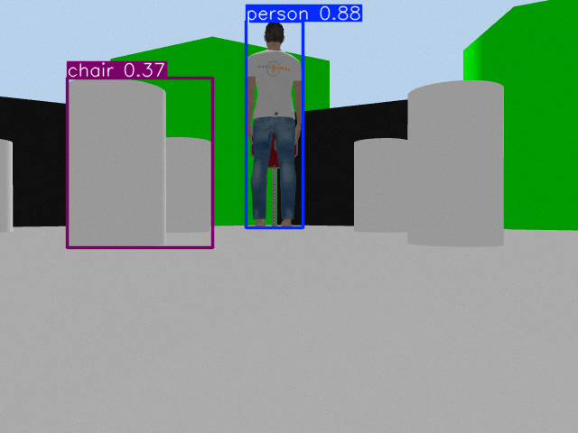
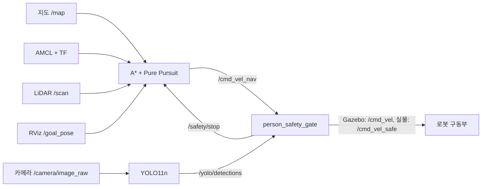

# my-car-astar

ROS 2에서 **TurtleBot3 생성 → 지도 기반 A* 경로 계획 → Pure Pursuit 주행 → YOLO 객체 탐지 → 사람 검출 시 정지**를 실행하는 작업공간입니다. ROS 패키지 이름은 `my_bot`입니다.

- Gazebo에서 Waffle Pi, 지도, AMCL, RViz, 카메라와 YOLO를 함께 실행합니다.
- 사람이 검출되면 속도를 0으로 만들고 기존 목적지와 경로를 취소합니다.
- 사람이 사라져도 정지를 유지하며, 수동 해제와 새 목적지가 필요합니다.
- 실물용 실행 구성은 **Waffle Pi / LDS-03 / Raspberry Pi CSI 카메라 / ROS 도메인 16**을 기준으로 준비했습니다. 실물 설치와 주행은 이번 작업에서 검증하지 못했습니다.

**Laya 연결 실험:** [PC/로봇 로컬 추론과 ROS 2 통신 프로토타입](docs/LAYA.md)을 추가했습니다. 실제 기본 모델의 로봇 상황 판단은 아직 정확하지 않아, 학습·평가 전에는 관찰 용도로 사용합니다. 기존 실행의 기본값은 Laya 판단을 요구하지 않습니다.



## 1. 실행 환경

| 항목 | 기준 |
| --- | --- |
| OS | Ubuntu 22.04, WSL2 Ubuntu 22.04에서 Gazebo 검증 |
| ROS | ROS 2 Humble |
| 시뮬레이터 | Gazebo Classic 11 |
| 로봇 | TurtleBot3 Waffle Pi, 카메라가 있는 Waffle도 시뮬레이션 인자로 선택 가능 |
| Python / 탐지 | Python 3.10, YOLO11n COCO, 기본 CPU 추론 |
| 속도 메시지 | `geometry_msgs/msg/Twist` |

Gazebo Classic 11과 Humble을 기준으로 작성했습니다. Gazebo Sim 또는 다른 ROS 배포판에서 동일하게 동작한다고 가정하지 않습니다.

## 2. 설치와 빌드

ROS 2 Humble이 설치된 Ubuntu에서 실행합니다. 비공개 저장소이므로 복제할 GitHub 계정에 접근 권한이 있어야 합니다.

```bash
git clone https://github.com/oioihoihoih/my-car-astar.git
cd my-car-astar

source /opt/ros/humble/setup.bash
# TurtleBot3를 소스로 설치했다면 해당 작업공간도 불러옵니다.
# source ~/turtlebot3_ws/install/setup.bash

sudo apt update
sudo apt install -y python3-colcon-common-extensions python3-venv python3-pip \
  python3-pytest python3-opencv \
  ros-humble-gazebo-ros-pkgs ros-humble-turtlebot3-gazebo \
  ros-humble-turtlebot3-bringup ros-humble-navigation2 ros-humble-nav2-bringup \
  ros-humble-cv-bridge ros-humble-rqt-image-view

python3 src/my_bot/scripts/setup_yolo.py --workspace "$PWD"
colcon build --symlink-install --packages-select my_bot
source install/local_setup.bash
ros2 pkg prefix my_bot
```

`setup_yolo.py`는 작업공간에 `.venv-yolo`를 만들고 CPU PyTorch, NumPy 1.x, OpenCV, Ultralytics를 설치합니다. ARM64와 x86의 PyTorch 다운로드 경로를 구분합니다. 모델과 Gazebo 에셋은 저장소에 포함되어 있습니다. 설치는 인터넷과 충분한 디스크 공간이 필요합니다.

`Package 'my_bot' not found`가 나오면 저장소 루트에서 빌드했는지와 **현재 터미널에서** `source install/local_setup.bash`를 실행했는지 확인합니다. 터미널의 현재 경로만 바꿔서는 패키지가 등록되지 않습니다.

## 3. Gazebo 생성과 주행

같은 ROS 도메인의 기존 Gazebo, teleop, 다른 주행 노드를 먼저 종료합니다. 다음 스크립트는 실행 위치와 관계없이 저장소의 설치 경로를 찾아 사용합니다.

### A* + Pure Pursuit + YOLO

```bash
bash scripts/run_simulation.sh
```

Waffle Pi가 `(-2.0, -0.5, yaw=0)`에 생성됩니다. Gazebo, RViz, 탐지 영상 창이 열리고, 위치 추정과 정상 카메라 관측이 준비되면 예제 목표 `(0.3, -0.5)`로 이동합니다. 첫 모델 로딩과 추론에 수십 초가 걸릴 수 있습니다.

자동 목표 없이 RViz에서 직접 목적지를 지정하려면:

```bash
bash scripts/run_simulation.sh demo:=false
```

RViz의 **2D Goal Pose**로 빈 공간을 클릭하고 최종 방향으로 드래그합니다. 청록색 경로를 따라 주행하고 목표 위치와 방향에 도달하면 정지합니다.

```bash
# 자동 예제 목적지 변경
bash scripts/run_simulation.sh demo_goal_x:=-1.0 demo_goal_y:=-0.5 demo_goal_yaw:=0.0

# 화면 없이 실행
bash scripts/run_simulation.sh gui:=false rviz:=false viewer:=false

# YOLO 없이 로봇 생성·지도·A* 주행만 실행: 사람 검출 정지 기능은 포함되지 않음
ros2 launch my_bot tb3_astar_simulation.launch.py
```

### 사람 등장과 정지 데모

```bash
bash scripts/run_person_stop_demo.sh
```

약 0.35m 이동하면 미리 로딩한 3D 사람이 카메라 시야로 들어옵니다. YOLO가 `person`을 검출하면 로봇이 정지합니다. 데모 사람은 낮은 카메라에서 전신이 보이도록 원본 모델의 0.7배로 배치했습니다.

직접 launch를 실행해도 같습니다.

```bash
ros2 launch my_bot tb3_astar_yolo_simulation.launch.py
ros2 launch my_bot tb3_person_stop_simulation.launch.py
```

두 launch를 동시에 실행하지 않습니다. `gui:=false rviz:=false viewer:=false` 인자는 사람 데모에도 적용됩니다.

## 4. 정지 상태 확인과 해제

다른 터미널에서도 ROS 설정, 작업공간 설정, 같은 `ROS_DOMAIN_ID`를 사용합니다.

```bash
source /opt/ros/humble/setup.bash
source install/local_setup.bash
ros2 topic echo /safety/status --once
ros2 topic echo /astar_status

# 수동으로 정지 잠금
ros2 service call /safety/stop_now std_srvs/srv/Trigger '{}'
```

사람을 시야 밖으로 옮기고 정상 영상이 연속 수신된 뒤 해제합니다. Gazebo 데모 사람은 아래 명령으로 제거할 수도 있습니다.

```bash
# Gazebo에서만 사용
ros2 service call /delete_entity gazebo_msgs/srv/DeleteEntity "{name: demo_person}"

# Gazebo 기본 3초 동안 정상 관측을 확인한 뒤 실행
ros2 service call /safety/reset std_srvs/srv/Trigger '{}'
```

사람이 보이거나 영상이 없으면 해제가 거부됩니다. 해제 후 RViz에서 **새 목적지**를 보내야 하며, 이전 경로는 재개하지 않습니다. 정지 기록은 `~/.ros/my_bot/person_stop_<ROS_DOMAIN_ID>.json`에 저장되어 노드 재시작 뒤에도 유지됩니다.

## 5. 노드와 데이터 흐름



| 노드 / 코드 | 역할 |
| --- | --- |
| `gazebo_ros/spawn_entity.py` | TurtleBot3의 SDF 모델을 Gazebo에 생성. `tb3_astar_simulation.launch.py`에서 실행 |
| `robot_state_publisher` | 로봇 URDF의 링크·관절 TF 발행 |
| `map_server`, `amcl` | 저장된 지도와 LiDAR를 이용한 위치 추정 |
| `astar.py` | 지도 좌표 변환, 장애물 확장, 8방향 A*, Pure Pursuit 계산 |
| `astar_pure_pursuit.py` | 지도·위치·목표·LiDAR를 받아 경로를 계획하고 속도 명령 발행 |
| `navigation_demo_goal.py` | 준비 상태 확인 후 예제 목적지를 한 번 발행 |
| `yolo_camera.py` | 최신 원본 영상에 YOLO 추론, 박스 영상과 JSON 결과 발행 |
| `person_stop_policy.py` | 사람 검출, 프레임 시각, 감시 주기, 해제 조건 판단 |
| `person_safety_gate.py` | 최종 속도 발행, 정지 잠금, 수동 해제 서비스, 상태 저장 |
| `actuator_watchdog.py` | 실물 SBC에서 안전 게이트 신호가 끊기면 모터 해제 요청 |
| `spawn_demo_person.py` | 주행 거리가 0.35m가 되면 사전 로딩한 사람 모델을 시야 안으로 이동 |

| 토픽 | 형식 / 의미 |
| --- | --- |
| `/map` | `nav_msgs/OccupancyGrid`, 1차원 데이터를 2차원 배열로 변환해 사용 |
| `/amcl_pose`, `/tf` | 위치 추정과 지도 기준 현재 로봇 위치 |
| `/scan` | `sensor_msgs/LaserScan`, 전방 장애물·센서 끊김 검사 |
| `/goal_pose` | `geometry_msgs/PoseStamped`, 지도 좌표의 목적지 |
| `/astar_path`, `/astar_costmap` | 경로와 로봇 여유 폭을 반영한 장애물 지도 |
| `/cmd_vel_nav` | 주행 노드의 원래 속도 명령 |
| `/cmd_vel` | Gazebo에서 안전 게이트가 발행하는 최종 `Twist` |
| `/cmd_vel_safe` | 실물 드라이버가 받는 최종 `Twist` |
| `/camera/image_raw` | `sensor_msgs/Image`, YOLO에 입력할 원본 영상 |
| `/yolo/image` | 박스와 신뢰도를 표시한 `sensor_msgs/Image` |
| `/yolo/detections` | `std_msgs/String`, 촬영 시각·감시 클래스·추론 시간·검출 결과를 담은 JSON |
| `/safety/stop`, `/safety/status` | 정지 여부 `Bool`과 상세 상태 JSON |

## 6. 설정과 동작 범위

주행 기본값은 [`config/astar_simulation.yaml`](src/my_bot/config/astar_simulation.yaml)에 있습니다.

| 설정 | 기본값 |
| --- | --- |
| 선속도 / 최대 회전 속도 | 0.12m/s / 0.6rad/s |
| Pure Pursuit 전방 거리 | 0.35m |
| 로봇 반경 + 여유 폭 | 0.22m + 0.05m |
| 목적지 허용 오차 | 0.15m |
| LiDAR 전방 정지 거리 | 0.30m |
| 사람 신뢰도 기준 | 0.35 |
| 검출 결과 미수신 / 최대 프레임 나이 | 각각 1초 |
| 주행 명령 미수신 | 0.25초 뒤 속도 0 |
| 해제 전 연속 정상 관측 | Gazebo 3초, 실물 1초, 최소 3프레임 |

탐지 대상에서 `person`을 제외하거나, 입력 영상·탐지 결과가 오래되거나 끊기면 움직임을 차단합니다. 감시는 Gazebo 시각과 별도의 실제 경과 시간으로 동작합니다.

A*는 저장된 정적 지도에서 계획합니다. 새 장애물을 만나면 LiDAR로 정지하며 자동 우회는 구현하지 않았습니다. 사람까지의 거리를 추정하지 않으며, 영상에 검출된 모든 `person`에 반응합니다.

## 7. 실물 TurtleBot3

**상세 절차: [실물 실행 안내](docs/HARDWARE.md)**

로봇 SBC에 이 작업공간과 필요한 패키지를 설치한 뒤, 기존 기본 bringup을 종료하고 아래 안전 bringup을 사용합니다.

```bash
# 로봇 SBC, 터미널 A
export ROS_DOMAIN_ID=16
export TURTLEBOT3_MODEL=waffle_pi
export LDS_MODEL=LDS-03
bash scripts/run_hardware_bringup.sh

# 별도 터미널: CSI 카메라 드라이버를 실행하고 실제 raw 영상 토픽 확인
ros2 launch turtlebot3_bringup camera.launch.py

# 위치 추정·주행·YOLO, 실제 공간에서 만든 지도 사용
bash scripts/run_hardware_navigation.sh "$HOME/maps/map.yaml" input_topic:=/camera/image_raw
```

실물은 처음에도 수동 해제가 필요합니다. 정상 카메라 관측과 위치 지정을 확인한 뒤 `/safety/reset`을 호출하고, 성공하면 운영자가 `/motor_power`를 켠 후 새 목적지를 보냅니다. 기존 주행 노드와 안전 bringup을 동시에 실행하지 않습니다.

## 8. 디렉터리

```text
my-car-astar/
├── README.md
├── scripts/                 # 경로에 의존하지 않는 실행 스크립트
├── docs/
│   ├── HARDWARE.md          # 실물 설치, 카메라, 정지 해제
│   ├── images/             # 실제 Gazebo 검출 화면
│   └── verification/       # 검증 결과 JSON과 테스트 기록
└── src/my_bot/
    ├── my_bot/             # 주행·탐지·안전 노드
    ├── launch/             # 로봇 생성, Gazebo, 실물 통합 실행
    ├── config/             # AMCL·주행 설정
    ├── maps/               # 시뮬레이션 지도 YAML/PGM
    ├── worlds/             # 표지판·사람이 있는 Gazebo 월드
    ├── models/             # 3D 에셋과 원 출처·라이선스
    ├── rviz/               # 지도·경로·카메라 시각화
    ├── weights/            # YOLO11n 가중치와 출처
    ├── scripts/setup_yolo.py
    └── test/               # A*·주행 정지·사람 감지 정책 테스트
```

기존 연습용 `go_to_goal`, `pure_pursuit_node`, `pure_pursuit_obstacle`와 이전 launch도 보관했습니다. 위 통합 실행은 `astar_pure_pursuit`를 사용합니다. 다른 주행 노드를 함께 실행하면 속도 명령이 충돌할 수 있습니다.

## 9. 검증

기존 정책·주행 제어 24개와 Laya 연결·게이트 16개, 총 40개 테스트를 통과했습니다.

```bash
source /opt/ros/humble/setup.bash
source install/local_setup.bash
PYTEST_DISABLE_PLUGIN_AUTOLOAD=1 python3 -m pytest -q -p no:cacheprovider \
  src/my_bot/test/test_astar.py \
  src/my_bot/test/test_astar_controller.py \
  src/my_bot/test/test_person_stop_policy.py \
  src/my_bot/test/test_laya_protocol.py \
  src/my_bot/test/test_laya_gate.py
```

- **Gazebo 통합 시험:** 약 0.38m 주행 뒤 실제 3D 사람을 `person 0.8796`으로 검출하고 정지. 사람 존재 중 해제 거부, 사라진 뒤 정지 유지, 수동 해제와 새 목표에 따른 재주행을 확인했습니다. Gazebo 시각을 일시 정지해도 영상 끊김 정지가 작동했습니다.
- **모터 인터페이스 시험:** 실제 ROS 인터페이스와 **모의** `/motor_power` 서비스에서 사람 정지 요청과 게이트 강제 종료 후 약 0.55초 뒤 독립 감시 노드의 모터 해제 요청을 확인했습니다. 실제 모터 시험 결과가 아닙니다.
- **이전 주행 시험:** A* + Pure Pursuit와 YOLO로 약 2.23m 이동, 목표 오차 0.071m, 이동 중 탐지 프레임 89개를 확인했습니다. 이는 사람 정지 기능 추가 전 기록이며 해당 JSON의 `/cmd_vel` 발행자는 이전 구성입니다.

원본 결과는 [`docs/verification`](docs/verification)에 있습니다. 시간 수치는 특정 실행에서 관측한 결과이며 최대 지연 보장이 아닙니다. 실물은 원격 접속이 되지 않아 설치·주행·실제 CSI 영상 시험을 수행하지 못했습니다.

이 기능은 카메라·YOLO 기반 소프트웨어 정지입니다. 시야 밖 사람이나 미검출을 막지 못하며 인증된 물리 비상 정지 장치를 대체하지 않습니다. 모터 torque-off는 기계식 브레이크가 아닙니다.

## 10. 에셋 출처

Gazebo 모델의 출처와 라이선스는 각 모델의 `SOURCE.txt`와 `LICENSE`에 포함했습니다. YOLO 가중치 출처는 [`weights/SOURCE.txt`](src/my_bot/weights/SOURCE.txt)에 있습니다. 자세한 항목은 [THIRD_PARTY_NOTICES.md](THIRD_PARTY_NOTICES.md)를 참고하세요.
